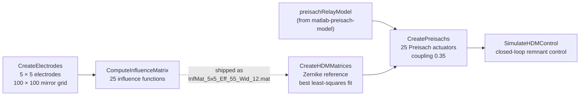

<div align="center">

# Hysteretic Deformable Mirror

**MATLAB simulation of a deformable mirror shaped by a 5 × 5 array of hysteretic (Preisach) actuators: influence functions, a Zernike reference shape and closed-loop remnant shape control.**

[](https://www.mathworks.com/products/matlab.html)
[](https://github.com/mavasbel-research/deformable_mirror/commits/main)
[](https://doi.org/10.1117/1.JATIS.7.2.029002)
[](https://doi.org/10.1364/AO.397472)


<sub>Mirror surface during the control loop (iteration 4, electrode 7)</sub>

</div>

> [!NOTE]
> Simulation files for the hysteretic deformable mirror project, part of the PhD thesis [*Multi-loop Hysteresis and Recursive Remnant Control*](https://doi.org/10.33612/diss.215199709) (University of Groningen, 2022).

## 📑 Contents

- [Pipeline](#-pipeline)
- [Model](#-model)
- [Requirements](#-requirements)
- [Getting started](#-getting-started)
- [Files](#-files)
- [Known issues](#-known-issues)
- [Related publications](#-related-publications)
- [Third-party code and license](#-third-party-code-and-license)

## 🔁 Pipeline



`WavefrontReconstruction.m` is a separate demo: it fits 36 Zernike polynomials to a noisy random surface by least squares.

## 📐 Model

| Element | Implementation |
|:---|:---|
| Electrodes | 25 square electrodes of width 0.12 on a 5 × 5 pitch, inside a circle of 55 % of the unit mirror radius |
| Influence functions | Deflection caused by each electrode, from an 80-term series integrated over 40 × 40 points per electrode and scaled by the surface tension $T$ |
| Reference shape | Zernike polynomial $n = 2,\ m = -2$, scaled to 100 nm peak-to-valley over the central part of the mirror |
| Mirror matrix | $H = (I + M K \bar E^\top)^{-1} M$, with influence matrix $M$, actuator stiffness $K$ and averaging masks $\bar E$ |
| Actuators | 25 Preisach operators; a pulse on one electrode reaches the others at 0.35 of its voltage |
| Target | The best least-squares fit $Z_{fit} = H\,H_Z^{+}\,Z_{ref}$ of the reference with this mirror |
| Control law | $e = Z_{fit} - Z$, $p = \max(H_Z^{+}e,\,0)$, $V \leftarrow V + 0.130\,p$, starting from 700 per electrode |
| Actuation | Global reset (0 → max → 0 → −800 → 0), then one 0 → $V_i$ → 0 pulse per electrode per iteration |
| Stop | $\max\lvert e\rvert \le 1\,\%$ of the fitted amplitude |

## 🧰 Requirements

| Requirement | Used by |
|:---|:---|
| MATLAB | all scripts |
| Parallel Computing Toolbox (`parfor`) | `ComputeInfluenceMatrix.m`, `WavefrontReconstruction.m` |
| `PreisachRelayModel` class and a `preisachRelayModel` instance | `CreatePreisachs.m` — from [matlab-preisach-model](https://github.com/mavasbel-research/matlab-preisach-model) |
| `zernike/` on the MATLAB path | `CreateHDMMatrices.m`, `WavefrontReconstruction.m` |

## 🚀 Getting started

1. Get the Preisach classes. They were removed from the last commit of matlab-preisach-model, so restore them from the previous one:
   ```bash
   git clone https://github.com/mavasbel-research/matlab-preisach-model.git
   git -C matlab-preisach-model checkout 7409024 -- Classes
   git clone https://github.com/mavasbel-research/deformable_mirror.git
   ```
2. In MATLAB, add `matlab-preisach-model/Classes` to the path and create a `preisachRelayModel` instance whose input range covers the levels used by the control script (700 initial input, −800 reset). The repositories do not record which model was used; `FitModel.m` in matlab-preisach-model builds one from measured loops. Do this first: the Preisach scripts start with `clear all`.
3. From the `deformable_mirror` folder, using the shipped influence functions:
   ```matlab
   addpath('zernike')
   CreateHDMMatrices     % loads InfMat_5x5_Eff_55_Wid_12.mat, builds H and the reference fit
   CreatePreisachs       % 25 actuators and the coupling matrix
   SimulateHDMControl    % runs until the error is within 1 %
   ```

Set `isRecording = true` in `SimulateHDMControl.m` to write `ControlTestVideo.mp4`. To recompute the influence functions instead of loading them, run `CreateElectrodes`, set `a = 1; T = 1;`, then run `ComputeInfluenceMatrix` (it saves `InfMat.mat`).

## 🗂️ Files

| File | Purpose |
|:---|:---|
| `CreateElectrodes.m` | Electrode corners, mirror grid and mask; plots the layout |
| `ComputeInfluenceMatrix.m` | 25 influence functions over the mirror grid |
| `InfMat_5x5_Eff_55_Wid_12.mat` | Precomputed electrode layout and influence functions (100 × 100 × 25) |
| `CreateHDMMatrices.m` | Scaled influence functions, Zernike reference, mirror matrices, best fit; saves `hdm_mirror_reference.eps` |
| `CreatePreisachs.m` | Actuator array `PhiArr` and coupling matrix `ECoup` |
| `SimulateHDMControl.m` | Reset, control iterations and `.eps` snapshots per iteration |
| `WavefrontReconstruction.m` | Standalone Zernike fitting demo |
| `MatUtils.m` | Masked matrix ↔ vector helpers |
| `zernike/`, `zernike.zip` | Zernike functions by Paul Fricker (same files; the zip uses Windows line endings) |

## ⚠️ Known issues

| Issue | Where |
|:---|:---|
| The `preisachRelayModel` instance used with this repository is not stored in either repository | `CreatePreisachs.m:6` |
| `a` and `T` are used but not defined in the repository | `ComputeInfluenceMatrix.m:32` |
| The computed file is saved as `InfMat.mat`, but `CreateHDMMatrices.m` loads `InfMat_5x5_Eff_55_Wid_12.mat` | `ComputeInfluenceMatrix.m:5`, `CreateHDMMatrices.m:7` |
| The control loop has no iteration limit | `SimulateHDMControl.m:77` |
| `WavefrontReconstruction.m` starts with `clear all` and wipes the workspace | `WavefrontReconstruction.m:1` |

## 📄 Related publications

| Year | Title | Venue |
|:---:|:---|:---|
| 2022 | [Multi-loop Hysteresis and Recursive Remnant Control](https://doi.org/10.33612/diss.215199709) | PhD thesis, University of Groningen |
| 2021 | [High pixel number deformable mirror concept utilizing piezoelectric hysteresis for stable shape configurations](https://doi.org/10.1117/1.JATIS.7.2.029002) | Journal of Astronomical Telescopes, Instruments, and Systems |
| 2020 | [Influence functions for a hysteretic deformable mirror with a high-density 2D array of actuators](https://doi.org/10.1364/AO.397472) | Applied Optics |

## ⚖️ Third-party code and license

- `zernike/` contains `zernfun`, `zernfun2` and `zernpol` by Paul Fricker, under the license in [`zernike/license.txt`](zernike/license.txt) (© 2016 The MathWorks, Inc.).
- This repository does not include a license file for its own code.

---

<div align="center">
<sub>Part of <a href="https://github.com/mavasbel-research">mavasbel-research</a> · <a href="https://github.com/mavasbel">Marco Vásquez Beltrán</a></sub>
</div>
